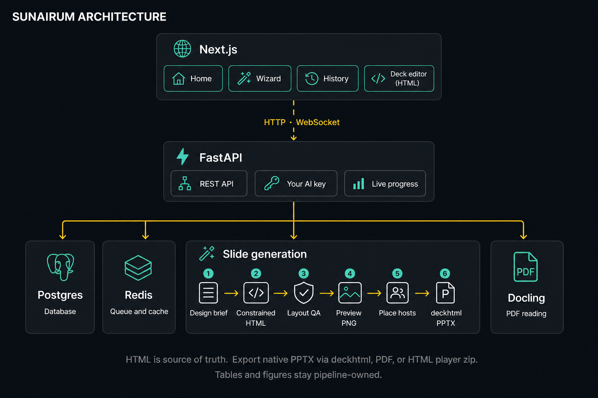
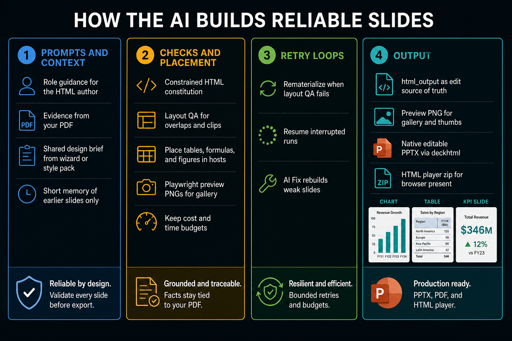

# Sunairum

*Intelligent Presentation Studio*


Transform ideas into polished, editable PowerPoint presentations in minutes — not hours.  
Use your own AI key and model with any OpenAI-compatible endpoint.

---

## Overview

**Sunairum** turns a short brief—or an uploaded PDF—into a **fully editable** PowerPoint. You can open it in PowerPoint, Keynote, or LibreOffice and change text, move shapes, edit tables, and adjust charts like a normal deck.

This is different from Gemini / NotebookLM slide exports, which often put **PNG pictures of slides inside a PPTX**. Those files look like PowerPoint, but you cannot freely rewrite a title or restyle a box the way you can with real objects. Sunairum exports real PowerPoint objects, not screenshot slides.

You bring your own AI key and model. Describe the talk, optionally attach a paper or report, pick a look if you want, and walk through a short wizard (audience, design direction, generate). When you upload a PDF, Sunairum extracts tables, figures, and formulas from that file and keeps claims tied to the source instead of inventing numbers.

Style packs only set the visual language (colors, type, mood). They do not force a fixed template of empty slots. Generation authors Constrained HTML into `html_output/` (the product source of truth), then exports native PowerPoint via deckhtml. After the deck is ready, you can tweak slides in the HTML deck editor and export PPTX, PDF, or a self-contained HTML player again.

| | **From a topic only** | **From an uploaded PDF** |
|---|---|---|
| **Default look** | The AI designs the slides from your brief. | Same flow, with facts taken from the PDF. |
| **Optional style pack** | Same flow, with your chosen visual style. | The pack sets the look; the PDF supplies the facts. |


---


## Table of Contents

- [Architecture](#architecture)
- [Built On](#built-on)
- [Comparison with Alternatives](#comparison-with-alternatives)
- [Features](#features)
- [Tech Stack](#tech-stack)
- [Getting Started](#getting-started)
- [Cloud Deployment](#cloud-deployment)
- [Desktop Apps (macOS)](#desktop-apps-macos)
- [Project Structure](#project-structure)
- [Configuration](#configuration)
- [Examples & Templates](#examples--templates)
- [API Endpoints](#api-endpoints)
- [License](#license)

---


## Architecture

<div align="center">



</div>

The web app talks to an API service. Background workers build the slides, parse PDFs, and compile PowerPoint files. Progress updates stream back to the browser while generation runs.

**Product path:** Constrained HTML (`html_output/`) → layout QA + preview PNGs → native PPTX via deckhtml. The in-browser deck editor edits **HTML**. You can also download a Deckflow-style **HTML player** zip (`index.html` with gzip-packed slides).

### How the AI work is organized

<div align="center">



</div>

Sunairum works as a short chain, not one long agent loop. It plans each slide first (what the page is for, how dense it should feel, and where reserved hosts sit), authors Constrained HTML under a strict allow-list, then runs cheap layout checks before any retry: overlaps, clips, and unpositioned boxes can rematerialize that slide from the plan. Preview PNGs are rendered with Playwright for the gallery. Tables, formulas, and figures from your PDF land in reserved hosts so the model does not invent cell values or equations. You can also run a focused “AI Fix” pass later if a few slides need another attempt.

---

## Built On

Sunairum’s generation path is its own: plan the page, author Constrained HTML as source of truth, validate layout, then export native PowerPoint with deckhtml. The model does not own the renderer. Tables, formulas, and figures sit on dedicated carriers. Cheap layout checks run before retries. PDF reading uses [Docling](https://github.com/docling-project/docling).

Style-reference example packs come from [ppt-master](https://github.com/hugohe3/ppt-master) by [@hugohe3](https://github.com/hugohe3). They are not the authoring or compile path. Around that, Sunairum is a guided web product: wizard, live previews, fail-closed PDF grounding, an HTML deck editor, and Docker-based local or cloud deploy.

---

## Comparison with Alternatives

What matters for most users is simple: can you start from a document, trust the facts, get a PowerPoint you can still edit, and run it with your own AI key if you want. The biggest practical difference versus Gemini / NotebookLM is editability: Sunairum ships **real PowerPoint objects**, while NotebookLM PPTX downloads are often **PNG slides wrapped in a PPTX**.

Here is how Sunairum compares with Google’s [NotebookLM](https://notebooklm.google/) slide decks (Gemini Notebook Slide Deck), Moonshot’s [Kimi Slides](https://www.kimi.com/), the open [ppt-master](https://github.com/hugohe3/ppt-master) toolchain, and [Presenton](https://github.com/presenton/presenton).

| | **Sunairum** | **NotebookLM (Gemini)** | **Kimi Slides** | **ppt-master** | **Presenton** |
|---|:---:|:---:|:---:|:---:|:---:|
| **Product form** | Self-host web app + 2 macOS desktop apps | Google cloud web app | Kimi cloud web app | Command line / agent | Self-host web app |
| **Bring your own AI key** | ✅ Any OpenAI-compatible model | ❌ Gemini only | ❌ Kimi models | ✅ | ✅ |
| **Run on your own server** | ✅ Docker | ❌ | ❌ | Local scripts | ✅ Docker |
| **macOS desktop apps** | ✅ Cloud-API app + fully offline app | ❌ | ❌ | ❌ | ❌ |
| **Start from a PDF or documents** | ✅ | ✅ Strong (many source types) | ✅ PDF, Word, sheets, images | ✅ CLI | ✅ |
| **Keep claims tied to sources** | ✅ Fail-closed on PDF runs | ✅ Source-grounded answers and decks | ⚠️ Citations supported; not fail-closed | ❌ | ❌ |
| **Export a PowerPoint file** | ✅ Also PDF and HTML player | ✅ Also PDF and share link | ✅ | ✅ | ✅ |
| **Fully editable PowerPoint (real objects)** | ✅ Text, shapes, tables, and charts stay editable | ❌ | ✅ Charts and SmartArt stay editable | ✅ | ⚠️ Limited |
| **Avoids PNG screenshot slides inside PPTX** | ✅ Native PowerPoint objects | ❌ Often PNG pictures of each slide | ✅ | ✅ | ⚠️ |
| **Live preview while generating** | ✅ | ✅ In the notebook studio | ✅ In Kimi | ❌ | ❌ |
| **Edit after generation** | ✅ HTML deck editor + AI Fix | ✅ Prompt revise per slide | ✅ In product, then in PowerPoint | ❌ | ✅ |
| **Guided strategy and design wizard** | ✅ Audience → design → generate | ❌ Source notebook → slide deck | ❌ Topic or files → Adaptive / Visual modes | ❌ | Outline edit |
| **Layout checked before PPTX** | ✅ HTML constitution + layout QA | ❌ | ⚠️ Model-driven | ⚠️ Agent-dependent | ❌ |
| **Rematerialize when layout fails** | ✅ Automatic checks | ⚠️ Manual prompt revise | ⚠️ Manual edit | ⚠️ Manual / agent | ❌ |
| **Tables, formulas, and figures from the PDF** | ✅ Placed into reserved regions | ⚠️ Visual slides from sources | ⚠️ Depends on upload and mode | ❌ | ❌ |
| **License** | Source-available (PolyForm Shield); commercial license for competing use | ❌ Proprietary | ❌ Proprietary | ✅ MIT | ✅ Apache 2.0 |

**How to read the table**

- **Editable vs PNG slides:** A `.pptx` download is not enough. Gemini / NotebookLM often packs **PNG images of slides** into PowerPoint, so you cannot freely edit text and shapes. Sunairum compiles **native PowerPoint objects**, so titles, boxes, tables, and charts remain fully editable after download.
- **NotebookLM (Gemini)** is excellent when your workflow already lives in Google’s notebook and you want a deck grounded in uploaded sources. You can revise slides with prompts and download PDF or PPTX, but deep PowerPoint editing is often blocked by those image slides.
- **Kimi Slides** aims at fast research-to-deck generation with Adaptive (deeper) and Visual (faster) modes, file uploads, and an editable PowerPoint export with native charts and SmartArt. It runs on Moonshot’s hosted Kimi models rather than your own key.
- **Sunairum** is a self-hosted product with its own HTML → deckhtml PPTX path (plus PDF and HTML player export), your own model key, fail-closed PDF grounding, and fully editable PowerPoint. Beside the web app there are two macOS desktop apps: one that keeps the UI local and talks to a remote API (`desktop/`), and one that runs the full stack offline on your Mac (`desktop-offline/`).
- **ppt-master** is a local agent skill: the model authors SVG pages and a compiler turns them into native PowerPoint. Sunairum keeps some of its example packs as visual references; it does not run that SVG authoring loop.

> Feature notes reflect public product docs and reviews as of August 2026. Cloud products change quickly.

---

## Features

### Your AI, your keys

Use any OpenAI-compatible text model from Settings. You can optionally add an image model too. Connection tests help confirm that keys and endpoints work before you start a long run.

### Guided wizard

| Stage | What you decide |
| ----- | --------------- |
| **1 · Strategy** | Who the talk is for, what you want them to take away, and how it will be delivered |
| **2 · Design** | Safe, shifted, or bold visual directions (colors, type, icons, imagery) |
| **3 · Generate** | Notes length, animations, images, and formula options, then start |

### From a PDF

Click Get Started and the editor opens right away. You see upload, parsing, and grounding progress on that page instead of waiting on the home button. Sunairum reads the PDF with Docling, pulls out tables, figures, and formulas, and keeps numbers and claims tied to that source. Equations are rendered cleanly, and figures can come from the paper when you choose them.

### How slides are authored

Every deck is authored as Constrained HTML (full pages, not a rigid empty template) into `html_output/`, then compiled to native PowerPoint with deckhtml. Before that HTML is written, the page gets a short visual plan: the job of the slide, how dense it should feel, and where reserved hosts sit. An optional style pack only influences look and feel. It does not copy the pack’s own subject text or figures into your deck. With or without a PDF, the same generation path runs. Each slide gets a fresh brief; earlier slides are remembered only as a short summary so the model does not stack old prompts forever.

### Layout and polish

Slides preview live as PNGs while they are created (Playwright). Layout QA catches overlaps, clips, and unpositioned hosts before release. Tables, formulas, and figures sit in their own host regions and are filled by the pipeline, not drawn as fake grids or typed TeX. Your chosen colors and fonts are preserved through HTML → PPTX export.

### Quality and recovery

Cheap layout checks run first. If text overlaps, clips, or lands unpositioned, Sunairum can rematerialize that slide from the plan rather than silently shuffling boxes. PDF-grounded decks refuse to release a download when claims cannot be traced. AI Fix can rebuild selected slides from the saved design plan. Failed or cancelled runs can be opened again and resumed (resume looks at `html_output/` / `preview/`).

### Progress and history

You see status updates and thumbnail previews as slides appear. You can cancel a run, resume later, and reopen unfinished projects from History.

### Languages

The wizard supports many content languages. The product UI is available in English and Turkish. Automatic language detection is available when you prefer not to pick one.

### Deck editor

Edit slides in the browser after generation on the **HTML canvas** (full-slide HTML with AI regenerate / Fix). Export PowerPoint, PDF, or a self-contained **HTML player** zip when you are done. Speaker notes attach to HTML slide stems.

### Speaker notes

Optional spoken notes can match a target talk length. Notes are written for speaking, not pasted as raw PDF sections. You can turn notes off for compile when you only need the slides.

### Settings and deploy

Store provider, model, base URL, and keys in Settings. Run locally or on a single server with Docker Compose. PDF parser models ship inside the worker image so first uploads do not need to download weights.

---

## Tech Stack

| Layer | Technology |
| ----- | ---------- |
| **Web app** | Next.js, TypeScript, Tailwind CSS |
| **API** | FastAPI (Python) |
| **Background jobs** | Celery and Redis |
| **Database** | PostgreSQL |
| **AI** | Your OpenAI-compatible provider |
| **PDF** | Docling (layout, tables, OCR) |
| **Slide preview** | Playwright (Chromium) → `preview/*.png` |
| **PowerPoint** | Native editable export via deckhtml (`html_output/` → PPTX) |
| **HTML player** | Gzip-packed slides in a self-contained `index.html` zip |
| **Live updates** | WebSocket |
| **Deploy** | Docker Compose |


---


## Getting Started


### Prerequisites

- Docker & Docker Compose v2
- An OpenAI-compatible LLM API key (cloud or local: Ollama, vLLM, LM Studio, …)


### Quick Start

1. **Clone:**
  ```bash
   git clone https://github.com/your-org/sunairum.git
   cd sunairum
  ```
2. **Optional secrets file** (LLM keys go in Settings UI):
  ```bash
   touch servers/fastapi/.env
  ```
3. **Launch:**
  ```bash
   docker compose up --build
  ```
4. **Open:**
  - App: [http://localhost:3000](http://localhost:3000)
  - API: [http://localhost:8000](http://localhost:8000)
  - Health: [http://localhost:8000/health](http://localhost:8000/health)

> PDF parser models ship inside the worker image, so the first upload does not need to download them.  
> Chromium for HTML measure + preview PNGs is enabled by default (`WITH_RENDERER=1`). Slim builds can set `WITH_RENDERER=0`, but generation needs the renderer.

---


## Cloud Deployment

Single Linux VM + Docker Compose. Caddy terminates TLS and serves frontend + API from one origin.

**Sizing:** 8+ GB RAM, 4 CPU (Docling peaks ~2.3 GB; worker concurrency is bounded). On DigitalOcean, `s-4vcpu-8gb` works. Platforms without persistent volumes are not supported.

### One-click Droplet

Paste [`deploy/cloud-init.yml`](deploy/cloud-init.yml) into user data (replace `CHANGE_ME`). Set `DOMAIN` for Let’s Encrypt.

### Existing host

```bash
git clone <your-fork> sunairum && cd sunairum
sudo ./deploy/install.sh
# Provider key → deploy/fastapi.env; DOMAIN → deploy/cloud.env
./deploy/up.sh
```

Prefer pulling prebuilt images (`IMAGE_PREFIX=… ./deploy/build-push.sh vX.Y.Z`) over building on the Droplet. Details: [`deploy/README.md`](deploy/README.md).

---


## Desktop Apps (macOS)

Two macOS desktop apps sit beside the web stack. Change the shared UI and API under `servers/`, then sync and build as below. Details: [`desktop/README.md`](desktop/README.md), [`desktop-offline/README.md`](desktop-offline/README.md).

### `desktop/` — local UI, cloud API

Runs the interface on your Mac and talks to a remote API. You need a network connection for login and generation.

```bash
cd desktop
npm install
npm run sync:ui && npm run build-ui   # after servers/nextjs changes
npm run fetch-node                   # once (vendors Node for the packaged app)
npm start                            # dev
npm run smoke
npm run dist:mac                     # → dist/Sunairum-*-arm64.dmg (Apple Silicon)
```

Optional API host (baked at `build-ui` time):

```bash
SUNAIRUM_API_URL=https://your-host.example npm run build-ui
```


### `desktop-offline/` — fully local stack

Runs the full stack on your Mac with no remote API. It copies from `servers/` into the app bundle and does not modify the original `servers/` or `desktop/` trees.

```bash
brew install redis                   # for scripts/fetch-redis.sh
cd desktop-offline
npm install
npm run build-resources              # one-time: redis + node + UI + Python/Docling (large)
# or lighter Python iterate:
# SKIP_DOCLING_MODELS=1 npm run build-python

npm run sync                         # servers/fastapi + nextjs → api/ + ui/ (+ patches)
# npm run sync:ui / npm run sync:api

npm run build-ui                     # after UI sync
npm start
npm run smoke
npm run dist:mac                     # → dist/Sunairum Offline-*-arm64.dmg

# if servers/fastapi/requirements.txt changed:
FORCE_PYTHON_REBUILD=1 SKIP_DOCLING_MODELS=1 npm run build-python
```

Both DMG builds use an `afterPack` hook so Next’s `.next/` and `node_modules/` are included (otherwise the UI ships unstyled).

---


## Project Structure

```
sunairum/
├── servers/
│   ├── fastapi/                 # API, workers, PDF parse, PowerPoint export
│   │   ├── tasks/               # HTML→PPTX pipeline, QA, grounding, notes
│   │   ├── vendor/deckhtml/     # Vendored HTML→PPTX converter
│   │   ├── sunairum_scripts/    # Image backends and PPTX helpers
│   │   ├── templates/           # Icons, charts, scaffolds
│   │   └── examples/            # Style packs (preview/ gallery source of truth)
│   └── nextjs/                  # Web app (home, wizard, HTML deck editor, history)
├── desktop/                     # macOS app with remote API
├── desktop-offline/             # Fully local macOS app
├── docs/                        # Diagrams and knowledge base
├── deploy/                      # Cloud install scripts
├── docker-compose.yml
└── docker-compose.cloud.yml
```

Per-project artifacts after generation: `html_output/`, `preview/`, `notes/`, `exports/`.

---


## Configuration


| Variable                        | Service    | Description                         | Default                 |
| ------------------------------- | ---------- | ----------------------------------- | ----------------------- |
| `SETTINGS_SECRET_KEY`           | FastAPI    | Encrypts stored API keys            | Required in prod        |
| `REDIS_URL`                     | API/Celery | Broker / pubsub                     | `redis://redis:6379/0`  |
| `DATABASE_URL`                  | API/Celery | Postgres                            | Compose-provided        |
| `STORAGE_MODE`                  | FastAPI    | `local` or `spaces`                 | `local`                 |
| `SOURCE_PARSER`                 | Celery     | PDF backend                         | `docling`               |
| `DOCLING_DEVICE`                | Celery     | `cpu` / `cuda` / `mps`              | `cpu`                   |
| `SOURCE_PARSER_TIMEOUT_SECONDS` | Celery     | Parse timeout                       | `900`                   |
| `DOCLING_FORMULA_ENRICHMENT`    | Celery     | LaTeX enrich (slow)                 | `0`                     |
| `HF_HUB_OFFLINE`                | Celery     | Offline Docling weights             | `1`                     |
| `WITH_RENDERER`                 | Build      | Bake Playwright Chromium into worker | `1`                    |
| `PLAYWRIGHT_BROWSERS_PATH`      | Celery     | Browser cache path                  | `/ms-playwright`        |
| Text / image keys & models      | —          | **Settings UI** (OpenAI-compatible) | Required via UI         |
| `LLM_REQUEST_TIMEOUT_SECONDS`   | API/Celery | LLM timeout                         | `180`                   |
| `NEXT_PUBLIC_API_URL`           | Next.js    | API base (local; empty = same-origin) | _(empty / rewrite)_   |


---


## Examples & Templates

Style packs live under `servers/fastapi/examples/`. They inspire colors, type, and mood. They are not rigid fill-in templates. Home gallery covers and Preview use baked `preview/*.png`. See `examples.json` for the full list. Rebake gallery PNGs with `python -m tasks.bake_gallery_previews --force` from `servers/fastapi`.

| Pack | Mood |
| ---- | ---- |
| Attention Is All You Need | Academic / technical |
| Swiss Grid Systems | Editorial grid |
| Brutalist AI Newspaper 2026 | High-contrast editorial |
| Kubernetes Blueprint 2026 | Infrastructure |
| Global AI Capital 2026 | Consulting |
| Fashion Weekly Digest | Magazine |
| Sugar Rush Memphis | Vibrant Memphis |
| …and more | See `examples.json` |


---


## API Endpoints


| Method | Endpoint | Description |
| ------ | -------- | ----------- |
| `GET` | `/health` | Health check |
| `GET` / `POST` | `/api/settings` | AI provider settings |
| `POST` | `/api/settings/test` | Test text or image credentials |
| `GET` / `DELETE` | `/api/projects` | List or delete projects |
| `DELETE` | `/api/projects/{id}` | Delete one project |
| `POST` | `/api/projects/{id}/upload_source` | Upload a PDF |
| `GET` / `POST` | `/api/projects/{id}/stage1` … `stage3` | Wizard steps |
| `POST` | `/api/projects/{id}/generate` | Start generation |
| `POST` | `/api/projects/{id}/generate/resume` | Resume a failed or cancelled run |
| `POST` | `/api/projects/{id}/generate/fix` | Rebuild selected slides |
| `POST` | `/api/projects/{id}/cancel` | Cancel generation |
| `GET` | `/api/projects/{id}/preview` | Live slide previews (PNG / HTML) |
| `POST` | `/api/projects/{id}/update_html` | Save HTML slide edits |
| `POST` | `/api/projects/{id}/generate/regenerate-slide` | AI regenerate one slide |
| `POST` | `/api/projects/{id}/rebuild` | Rebuild PowerPoint from `html_output/` |
| `GET` | `/api/templates` · `…/cover` · `…/slides` | Style-pack gallery (PNG thumbs) |
| `GET` / `POST` | `/api/projects/{id}/notes/…` | Speaker notes helpers |
| `GET` | `/api/download/{id}.pptx` | Download PowerPoint |
| `GET` | `/api/download/{id}.pdf` | Download PDF |
| `GET` | `/api/download/{id}.html.zip` | Download HTML player zip |
| `GET` | `/api/catalogs` | Canvas and font catalogs |
| `WS` | `/ws/{id}` | Live progress stream |


---

## License

Sunairum original code is **source-available** under the [PolyForm Shield License 1.0.0](LICENSE) — not OSI open source.

- You may use, modify, and share the code for purposes that do **not** compete with Sunairum.
- You may **not** pull this repository and sell it, resell it, or host it as a competing product or service without a separate [commercial license](COMMERCIAL_LICENSE.md).
- Example packs from [ppt-master](https://github.com/hugohe3/ppt-master) remain MIT; fonts, icons, and other third-party assets keep their original licenses. See [NOTICE.md](NOTICE.md).